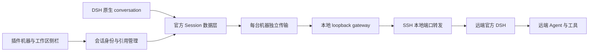

# 插件设计

产品约束见 [PROJECT.md](./PROJECT.md)，当前接口与兼容点见 [B-INTEGRATION.md](./B-INTEGRATION.md)。

侧栏节点使用标记 DOM，原生 conversation 继续由 DSH 渲染。插件将真实远端数据绑定到官方 Session 对象，复用原生发送、队列、工具与交互组件。

机器配置、HTTP 认证、SSH 进程由 Host 插件管理；远端工作区、事件、投影、权限和模型目录由 Client 插件按机器维护。身份字段在传输边界转换，消息正文和附件保持原值。

运行时服务包装集中在 `client/native-adapter.js`，释放逻辑集中在 `client/lifetime.js`，版本检查集中在 `client/compatibility.js`。`client/source.js` 负责侧栏与远端状态，协议映射集中在 `client/transport.js`，官方模块入口集中在 `build.mjs` 和 `client/entry.js`。升级通过独立 lab 验证，不修改 DSH 安装文件。
